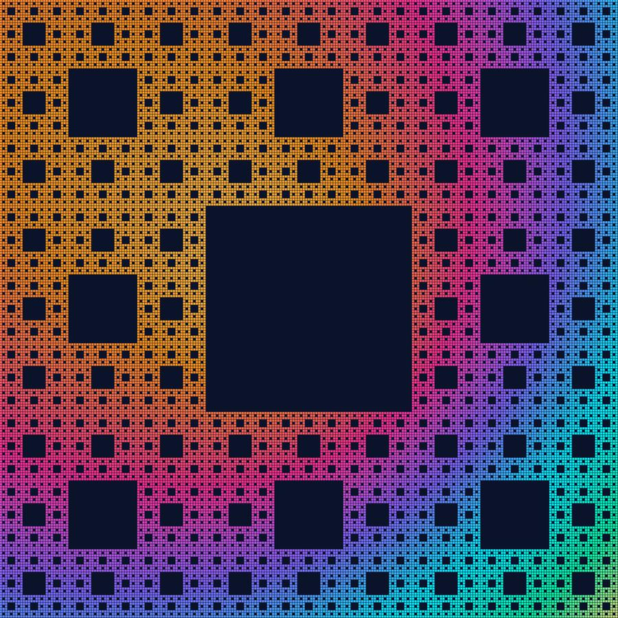

# rollody-sketches

Standalone Python sketches for the math and generative art animations on [@RollodyStudio](https://www.youtube.com/@RollodyStudio).

Each sketch is a single self-contained file using only `numpy` and `pillow` so it runs cleanly on Windows, macOS, and Linux without C-extension setup.

<p align="center">
  
  
</p>

## Setup

```bash
pip install -r requirements.txt
```

## Sketches

| Sketch | File | Video | Command |
|---|---|---|---|
| Sierpinski Carpet (32,768 Squares) | `sketches/sierpinski_flip.py` | — | `python sketches/sierpinski_flip.py` |
| 3D Polar Harmonic Lotus | `sketches/lotus_bloom.py` | [Watch Short](https://youtube.com/shorts/7ZJ0sNEhubY) | `python sketches/lotus_bloom.py` |

### Examples

```bash
# 32,768-square Sierpinski carpet PNG or zoom GIF
python sketches/sierpinski_flip.py --level 5
python sketches/sierpinski_flip.py --gif

# 13-petal 3D lotus PNG, custom petal count, or blooming GIF
python sketches/lotus_bloom.py
python sketches/lotus_bloom.py --petals 21 --shells 30 --out lotus_21.png
python sketches/lotus_bloom.py --gif
```

## License

MIT
